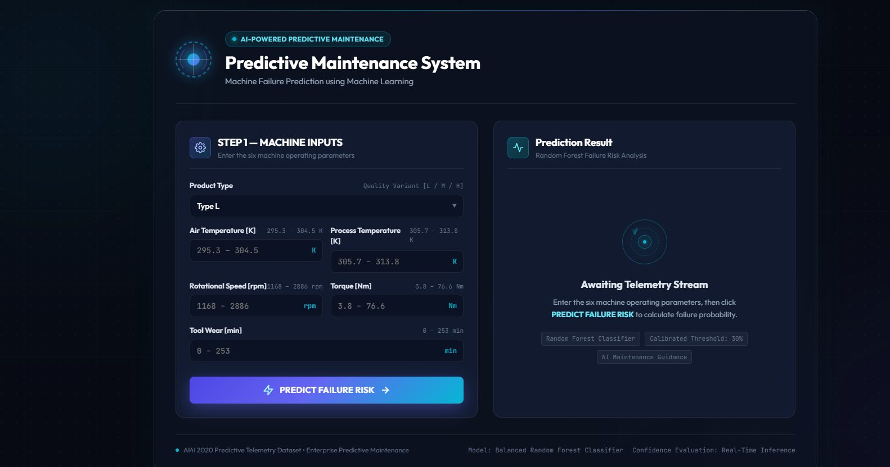
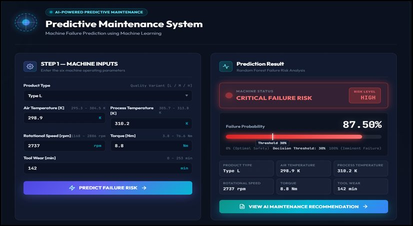
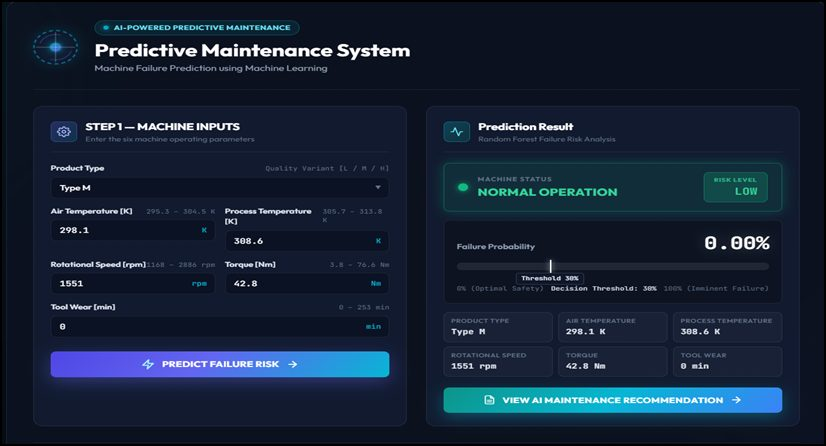
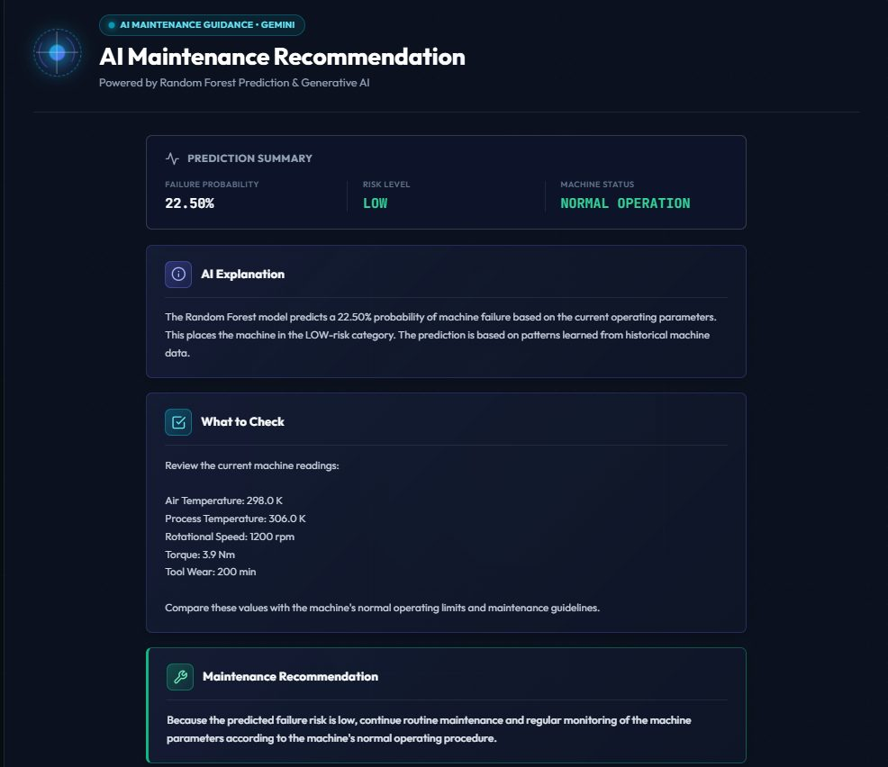
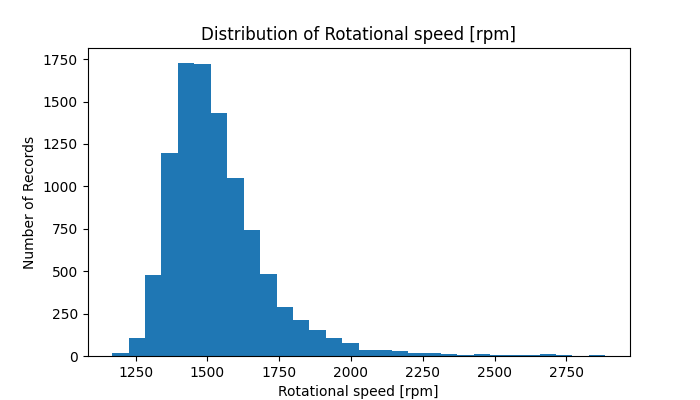
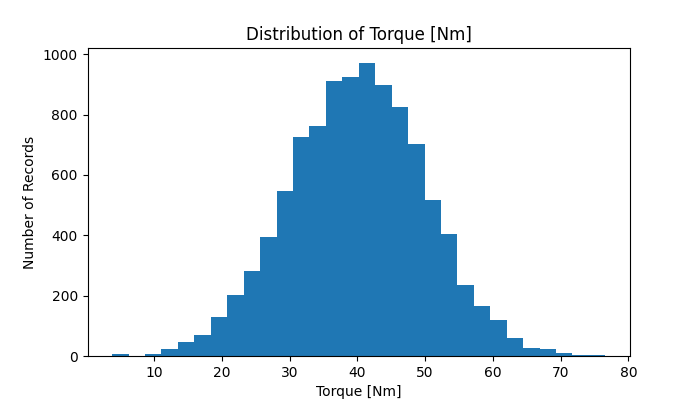
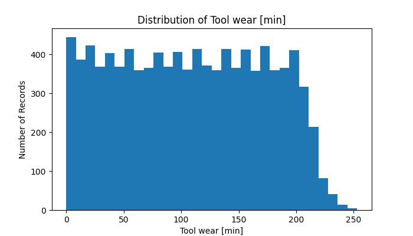
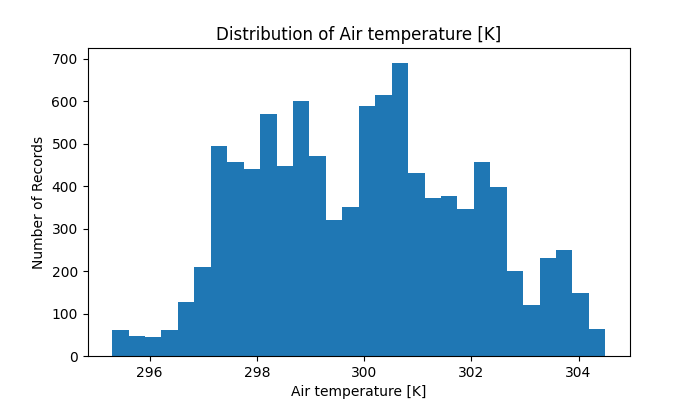
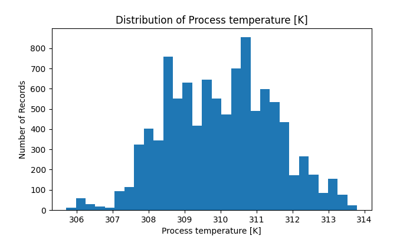

<div align="center">

# ⚙️ Predictive Maintenance System in Smart Manufacturing Using Machine Learning and GenAI

### Predict machine failure. Understand the risk. Support preventive maintenance.

A machine-learning-based predictive maintenance web application for smart manufacturing. It uses operating parameters to estimate machine failure risk and integrates Google Gemini to explain the model output and provide advisory maintenance guidance.


[📂 GitHub Repository](https://github.com/nithi-05K/Predictive_Maintenance_AI)

</div>

---

## 📌 Project Overview

Unexpected machine failures can interrupt manufacturing operations and lead to unplanned maintenance. This project explores how machine operating data can be used to estimate failure risk before maintenance decisions are made.

The application uses the **AI4I 2020 Predictive Maintenance Dataset** and a Random Forest classifier to estimate the probability of machine failure from six input parameters. A Flask web interface allows users to enter machine operating values and view the prediction. Google Gemini is integrated after the machine-learning prediction to provide a natural-language explanation and general maintenance guidance.

> **Important:** The Random Forest model is responsible for the failure prediction. Gemini provides an advisory explanation; it does not make or override the prediction.

## ✨ Key Features

### 1. Machine Operating Parameter Input
- Select the product type: L, M, or H.
- Enter air temperature and process temperature.
- Enter rotational speed, torque, and tool wear.
- Submit the values through a web-based form.

### 2. Machine Failure Risk Prediction
- Uses a trained Random Forest classifier.
- Estimates failure-class probability using the input parameters.
- Applies a 30% decision threshold to classify the prediction.
- Displays a risk category and machine status.

### 3. AI-Powered Maintenance Explanation
- Integrates the Google Gemini API.
- Explains the Random Forest prediction in natural language.
- Highlights relevant input parameters.
- Provides general preventive-maintenance guidance.
- Clearly identifies Gemini's response as advisory.

### 4. Web-Based Interface
- Built using Flask, HTML and CSS.
- Displays prediction results and submitted machine parameters.
- Presents model output and AI-generated explanation in one interface.

## 🖥️ Application Demonstration

### 1. Main Dashboard

The dashboard allows the user to enter the six machine operating parameters and submit them for failure-risk analysis.



*Main dashboard before a prediction is submitted.*

### 2. High Failure-Risk Prediction

This example displays a high-risk prediction with the estimated failure probability, risk level, and machine status.



### 3. Normal Operation Prediction

This example displays a normal-operation result with a low estimated failure probability.



### 4. Gemini AI Maintenance Explanation

After the Random Forest prediction, Gemini provides a natural-language explanation, highlights the supplied parameters, and offers general maintenance guidance.



*Gemini output is advisory; the Random Forest model remains responsible for the failure prediction.*

## 🧠 Machine Learning Workflow

1. **Dataset loading:** Load the AI4I 2020 dataset.
2. **Feature selection:** Use six operating-condition inputs and the Machine Failure target.
3. **Preprocessing:** Encode the categorical product type using one-hot encoding.
4. **Data splitting:** Split the records into training and testing sets using stratification.
5. **Model training:** Train a Random Forest classifier with 200 decision trees and class balancing.
6. **Probability estimation:** Use the trained model's `predict_proba` output to estimate failure-class probability.
7. **Threshold-based decision:** Apply the selected 0.30 threshold to classify the prediction.
8. **AI explanation:** Send the input parameters and model output to Gemini for an advisory explanation.

### Input Parameters

| Parameter | Description |
|---|---|
| Product Type | Dataset category: L, M or H |
| Air Temperature [K] | Air temperature |
| Process Temperature [K] | Process temperature |
| Rotational Speed [rpm] | Rotational speed |
| Torque [Nm] | Torque |
| Tool Wear [min] | Tool wear duration |

**Target:** Machine Failure (0 = No Failure, 1 = Failure)

The original dataset includes additional identifier and failure-mode columns. This project uses the six operating-condition features for its prediction setup.

## 🏗️ System Architecture

```text
        User
         |
         v
  Flask Web Interface
   (HTML + CSS)
         |
         v
  Machine Parameter Input
         |
         v
  Random Forest Model
         |
         v
  Failure Probability
         |
         v
  Threshold-Based Decision
         |
         +----------------------+
         |                      |
         v                      v
  Risk Level & Status     Google Gemini API
         |                      |
         |                      v
         |              AI Explanation &
         |              Maintenance Guidance
         |                      |
         +----------+-----------+
                    |
                    v
             Results on Web UI
```

## 🛠️ Technologies Used

| Technology | Purpose |
|---|---|
| Python | Main programming language |
| Pandas | Dataset handling and preprocessing |
| Scikit-learn | Random Forest model and evaluation |
| Joblib | Saving and loading the trained model |
| Matplotlib | Exploratory data analysis and plots |
| Flask | Backend web application |
| HTML and CSS | User interface |
| Google Gemini API | Natural-language explanation and maintenance guidance |
| python-dotenv | Loading API credentials from environment variables |

## 📊 Dataset

**AI4I 2020 Predictive Maintenance Dataset**

The project uses the AI4I 2020 dataset, a synthetic dataset designed for predictive maintenance research and modeled around an industrial milling-machine scenario.

- Total records: 10,000
- Original columns: 14
- Selected input features: 6
- Target column: Machine Failure

Dataset source: [UCI Machine Learning Repository – AI4I 2020 Predictive Maintenance Dataset](https://archive.ics.uci.edu/dataset/601/ai4i+2020+predictive+maintenance+dataset)

## 📈 Exploratory Data Analysis

Exploratory data analysis was used to inspect the distributions of the numerical operating parameters in the selected dataset. The histograms below show the recorded values for rotational speed, torque, tool wear, air temperature and process temperature.

| Feature distribution | Plot |
|---|---|
| Rotational speed |  |
| Torque |  |
| Tool wear |  |
| Air temperature |  |
| Process temperature |  |

Note: `Figure_6.png` is also retained in the `eda_plots/` folder; it is a duplicate of the air-temperature plot.

## 📁 Project Structure

```text
Predictive_Maintenance_AI/
│
├── ai4i2020.csv
├── predictive_maintenance_model.pkl
│
├── app.py
├── data_preparation.py
├── predict.py
├── validate_model.py
├── threshold_testing.py
│
├── templates/
│   ├── index.html
│   └── recommendation.html
│
├── static/
│   └── style.css
│
├── screenshots/
│   ├── dashboard.jpg
│   ├── failure-risk.jpg
│   ├── normal-operation.jpg
│   └── gemini-explanation.jpg
│
├── eda_plots/
│   ├── Figure_1.png
│   ├── Figure_2.png
│   ├── Figure_3.png
│   ├── Figure_4.png
│   ├── Figure_5.png
│   └── Figure_6.png
│
├── .gitignore
├── requirements.txt
└── README.md
```

## 🚀 Local Setup

### Prerequisites

- Python 3.10 or later
- pip
- Google Gemini API key (optional; required for live Gemini explanations)

### 1. Clone the repository

```bash
git clone https://github.com/nithi-05K/Predictive_Maintenance_AI.git
cd Predictive_Maintenance_AI
```

### 2. Create and activate a virtual environment

Windows:

```bash
python -m venv .venv
.venv\Scripts\activate
```

### 3. Install dependencies

Install the dependencies listed in the repository's `requirements.txt` file:

```bash
pip install -r requirements.txt
```

### 4. Configure the Gemini API key (optional)

Create a local file named `.env` in the project root:

```env
GEMINI_API_KEY=your_gemini_api_key
```

Do not upload your `.env` file or expose your API key publicly. The application can still provide the machine-learning prediction when Gemini is unavailable; the AI explanation will use the application's fallback message.

### 5. Run the application

```bash
python app.py
```

Open the local address shown by Flask in your browser, normally:

`http://127.0.0.1:5000`

## ▶️ Other Scripts

Run the data preparation, model training and saving workflow:

```bash
python data_preparation.py
```

Run the terminal-based predictor:

```bash
python predict.py
```

Run model validation:

```bash
python validate_model.py
```

Run these scripts from the project root directory.

## 🔮 Future Enhancements

- Integrate live machine sensor data using IoT devices.
- Add historical prediction and maintenance records.
- Improve model evaluation using a separate validation strategy.
- Develop a monitoring dashboard for multiple machines.
- Deploy the application to a cloud platform.

## ⚠️ Limitations

- The current application accepts manually entered operating parameters; it is not connected to live industrial sensors.
- Predictions depend on the dataset and trained model and should not be treated as confirmation of an actual machine fault.
- Gemini output is advisory and may be unavailable when API access or service capacity is limited.
- The system is a prototype and should not be used as the sole basis for operational or safety-critical maintenance decisions.

